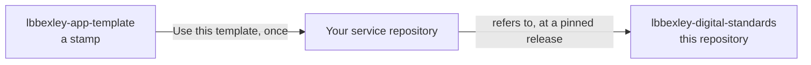

# Bexley AI build harness

Build London Borough of Bexley Power Platform services with an AI coding assistant, to the council's brand, accessibility and legal standards. The harness works with **Claude Code** and with **GitHub Copilot** in VS Code, for canvas apps, Power Pages sites, Copilot Studio agents, Power Automate flows, Dataverse and model-driven apps.

This repository holds the standards themselves. You don't work in it: you create your own repository for your service, and it follows these standards automatically.

> [!IMPORTANT]
> Dev environments and fictional data only. Never put real resident or staff information into a prompt, a file, a screenshot or a pull request.

## About the harness

An AI assistant can build a canvas app screen or a Copilot Studio topic in minutes, but quick isn't the same as accessible, lawful and on brand. The harness gives the assistant the council's standards as skills it follows, and makes it check its own work:

- **Plan** on the strongest model, with the real words users will read and acceptance criteria someone can check.
- **Build** on the everyday model, directly in the dev environment, with Microsoft's tools for canvas apps, flows, Dataverse and Power Pages. The standards check runs on everything the assistant writes, and sends every problem straight back to it.
- **The latest version comes into the repository.** After a change in the dev environment, the assistant brings it in with `pac solution sync`, and a canvas app's source through Microsoft's canvas tools. The service repository keeps the guidelines and the latest version: nobody edits the service's source there by hand.
- **Check** on a smaller model before the assistant can finish: the standards check on everything that changed, and a review for what tools can't see.
- **Committed and pushed for you.** Once the check passes, the assistant commits the latest version and pushes it to GitHub. Nobody has to run Git.
- **On GitHub**, every push and every pull request is checked again, whichever assistant made the change, or none.

Zero findings of any severity is the definition of done.

## Where things live

| Repository | Whose it is | What you do with it |
|---|---|---|
| **Your service repository**, named `lbbexley-` and your service, for example `lbbexley-parking-permits` | Yours, in your own GitHub account or your team's | All your work happens here. You create it once, from the template |
| [lbbexley-app-template](https://github.com/dbraben/lbbexley-app-template) | The harness's | Select **Use this template** to create your own repository. Never change the template itself |
| lbbexley-digital-standards (this repository) | The harness's | Nothing: your repository refers to it automatically. Raise issues here when a check is wrong or you have an idea |
| [lbbexley-ai-build-workshop](https://github.com/dbraben/lbbexley-ai-build-workshop) | The harness's | Read the exercises. They take you through creating and using your own repository |

The harness repositories live on `github.com/dbraben` during the pilot, and will move to the council's GitHub.

## Getting started

### In a workshop

The [Bexley AI build harness workshop](https://github.com/dbraben/lbbexley-ai-build-workshop) takes you from nothing to a reviewed first piece of your service, built in your dev environment and kept in your own repository, on a project of your own: you bring the requirements, from a recorded Teams meeting or in your own words. It takes about half a day, and has a track for each assistant.

### On your own

You need:

- a GitHub account
- Claude Code's command-line version with a Claude Pro or Max subscription, or GitHub Copilot with agent mode in VS Code
- VS Code, Git and Node.js 22 or later
- a Power Platform dev environment from the Digital Team, with Dataverse and the Bexley publisher (prefix `lbbexley`)

Set your AI account's privacy settings first: the [onboarding guide](docs/onboarding.md) says how. Then create your own repository and turn the standards on.

**With Claude Code**

1. Sign in to GitHub, open [lbbexley-app-template](https://github.com/dbraben/lbbexley-app-template) and select **Use this template** (top right, beside **Star**), then **Create a new repository**. Choose your own account as the owner, name it `lbbexley-` followed by your service, for example `lbbexley-parking-permits`, and make it private.
2. Clone **your** repository, open it in VS Code, and trust the folder.
3. Run `claude` in VS Code's terminal and accept its offer to add the Bexley plugin. Check it's on with `/plugin`.
4. Run `/lbbexley:new-app` and answer the questions about your service.
5. Run `/lbbexley:requirements`. Claude asks about the service in the chat, a few questions at a time, or gives you the questions as a table to answer with the service team and paste back later. Then run `/lbbexley:architect`.
6. For each change: describe it in plan mode, read and approve the plan, and let Claude build it in the dev environment and the end-of-run check finish. Claude brings in the latest version, then commits and pushes it for you. Run `/lbbexley:review` before you call a story done.

**With GitHub Copilot**

1. Sign in to GitHub, open [lbbexley-app-template](https://github.com/dbraben/lbbexley-app-template) and select **Use this template** (top right, beside **Star**), then **Create a new repository**. Choose your own account as the owner, name it `lbbexley-` followed by your service, for example `lbbexley-parking-permits`, and make it private.
2. Clone **your** repository, open it in VS Code, and trust the folder.
3. Open the chat view in **Agent** mode. The Bexley agents, skills and rules are already in your repository: check the agent picker lists **lbbexley-plan**, **lbbexley-build** and **lbbexley-check**.
4. Choose **lbbexley-build** and ask it to use the **lbbexley-new-app** skill. Answer the questions about your service.
5. Ask **lbbexley-plan** to use the **lbbexley-requirements** skill. Copilot asks about the service in the chat, a few questions at a time, or gives you the questions as a table to answer with the service team and paste back later. Then use **lbbexley-architect**.
6. For each change: plan it with **lbbexley-plan**, select **Build this plan** (it builds in the dev environment and syncs the latest version), then **Check my work**, then **Commit the work**, which commits and pushes it. Use the **lbbexley-review** skill before you call a story done.

## Commands you'll use

| To | Claude Code | GitHub Copilot |
|---|---|---|
| Set up a new service | `/lbbexley:new-app` | The lbbexley-new-app skill |
| Work out the requirements, in the chat | `/lbbexley:requirements` | The lbbexley-requirements skill, with lbbexley-plan |
| Design a service | `/lbbexley:architect` | The lbbexley-architect skill, with lbbexley-plan |
| Plan a change | Plan mode, or `/lbbexley:plan` | The lbbexley-plan agent |
| Bring the latest version from the dev environment into the repository, after you've changed something there yourself | `/lbbexley:sync` | The lbbexley-sync skill, with lbbexley-build |
| Review a story before it's done | `/lbbexley:review` | The lbbexley-review skill |
| Work through ideas for the harness | `/lbbexley:improve` | The lbbexley-improve skill |

In a terminal in your repository, with either assistant:

| To | Run |
|---|---|
| Clean a Teams meeting transcript (you run this, never the assistant) | `npm run transcript:clean -- <path to the transcript>` |
| Check what you've changed against the standards | `npm run check` |
| Check everything | `npm run check:all` |
| Run the accessibility tests | `npm run test:a11y` |
| Save a sign-in for the accessibility tests | `npm run test:a11y:login` |
| Check the compliance documents are complete before go-live | `npm run check:release` |
| Move to a new release of the standards | `npm run standards:update -- <version>` |

## How your repository connects to the standards

Your repository refers to these standards in four places: the Claude Code plugin settings and the pull request check, both pinned to the same release, copies of the standards at that release for Copilot and the local checks, and the `standards:update` command, which moves them all to a new release. Never edit those copies by hand: the pull request check fails if you do, and the next update replaces them.

## The rules that always apply

- Work only in a dev environment, with fictional data.
- Meeting transcripts stay outside your repository. Only a cleaned copy, read through by a person, goes to an assistant.
- Pipelines deploy to test and production, never people or assistants.
- Every page, screen and agent topic goes into its test list in the same change that builds it.
- Never weaken a check, delete a test or add a suppression without a written reason.

## What's in this repository

| Part | What it does |
|---|---|
| **Skills** (`plugins/lbbexley/skills/`) | The standards, written as instructions the assistant loads when they're relevant: brand, accessibility, content style, publicity, data protection, equality, AI transparency, one skill per platform, and the skills for requirements, design, planning, checking and improving the work |
| **Agents** (`plugins/lbbexley/agents/`) | Three read-only reviewers: accessibility and compliance (used by the review), and the end-of-run reviewer, which runs on a smaller model at the end of every piece of work |
| **Guardrails** (`plugins/lbbexley/hooks/`) | Stop prompts that contain real-looking personal data, keep the assistant to the dev environment (Dataverse, Power Automate and `pac`), block deletes, check every file the assistant saves, note every change to the dev environment, and hold the assistant back at the end of a run until the latest version is in the repository, passes and has been reviewed, then have it committed and pushed |
| **Standards check** (`plugins/lbbexley/scripts/lbbexley-check.js`) | 41 mechanical rules, many mapped to WCAG 2.2, used after each save, at the end of each run, from the command line, and on every pull request. Any finding fails it |
| **Transcript cleaner** (`plugins/lbbexley/scripts/clean-transcript.js`) | Makes a copy of a Teams meeting transcript that's safe to use for requirements: speakers named by role, contact details and reference numbers removed, and names kept next to the original, outside the repository |
| **Pull request check** (`.github/workflows/standards-check.yml`) | A reusable workflow every service repository calls, so code is checked whatever tool wrote it |
| **App sync** (`scripts/sync-app.js`, `sync/`) | Brings a service repository in line with a release: path rules for Claude Code and Copilot, Copilot's skills, agents and hooks, a copy of the standards scripts, and the accessibility test runner |

## Getting help

- The [onboarding guide](docs/onboarding.md): tools, set-up, how to work, and troubleshooting.
- [Getting help](SUPPORT.md): who to ask.
- A check you think is wrong, or an idea for the standards: [open an issue](https://github.com/dbraben/lbbexley-digital-standards/issues/new/choose) in this repository.

## Looking after the harness

The Digital Team owns this repository.

| For | See |
|---|---|
| Publishing the harness and running the pilot | [docs/setup.md](docs/setup.md) |
| How changes are agreed, sign-offs, risks and open decisions | [GOVERNANCE.md](GOVERNANCE.md) |
| Suggesting or making a change | [CONTRIBUTING.md](CONTRIBUTING.md) |
| Releasing a version | [docs/maintaining.md](docs/maintaining.md) |
| Reporting a security problem | [SECURITY.md](SECURITY.md) |

## Sources

- B:HIVE: Digital design guidelines – colour and typography, and the digital accessibility how-to guides (Digital Team, with Shaw Trust)
- Code of Recommended Practice on Local Authority Publicity (2011), under the Local Government Act 1986
- The Public Sector Bodies (Websites and Mobile Applications) (No. 2) Accessibility Regulations 2018, and WCAG 2.2
- UK GDPR and the Data Protection Act 2018, as amended by the Data (Use and Access) Act 2025; the Privacy and Electronic Communications Regulations
- Equality Act 2010; Freedom of Information Act 2000; Environmental Information Regulations 2004
- Algorithmic Transparency Recording Standard
- The architect skill follows the approach of the open-source power-platform-architect plugin in github/awesome-copilot (MIT licence), adapted for Bexley.

If a skill and an official source disagree, the official source wins. Tell the Digital Team so the skill can be corrected.
