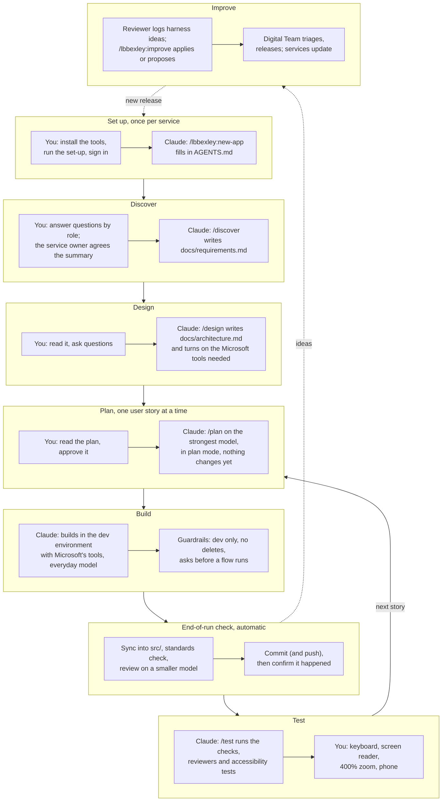
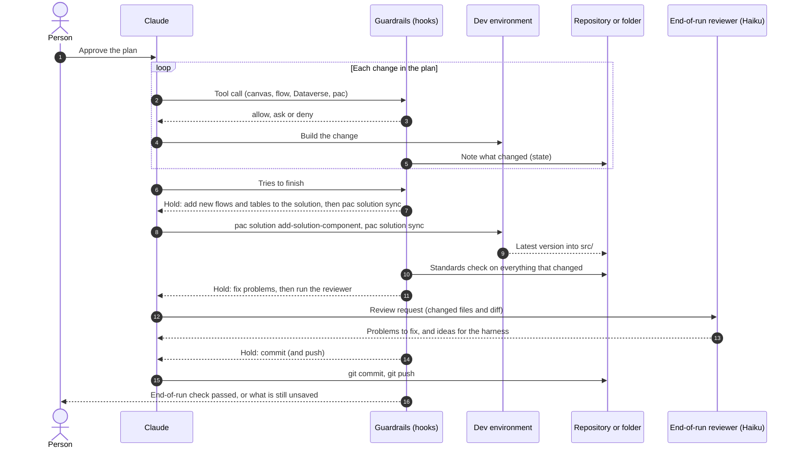
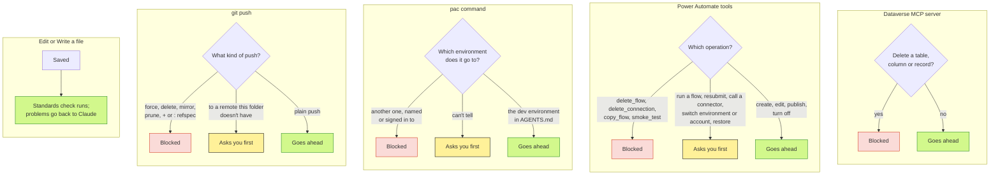
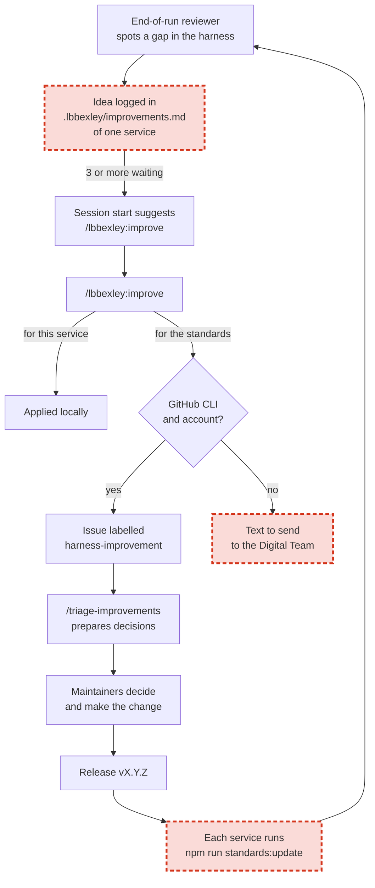
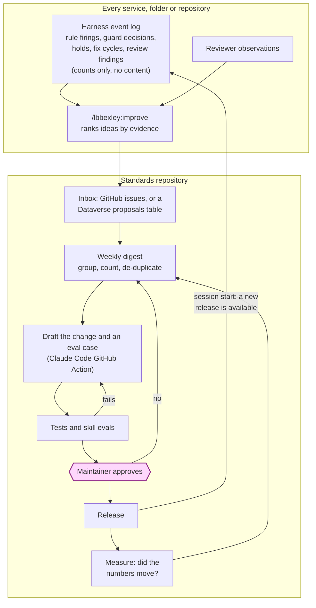
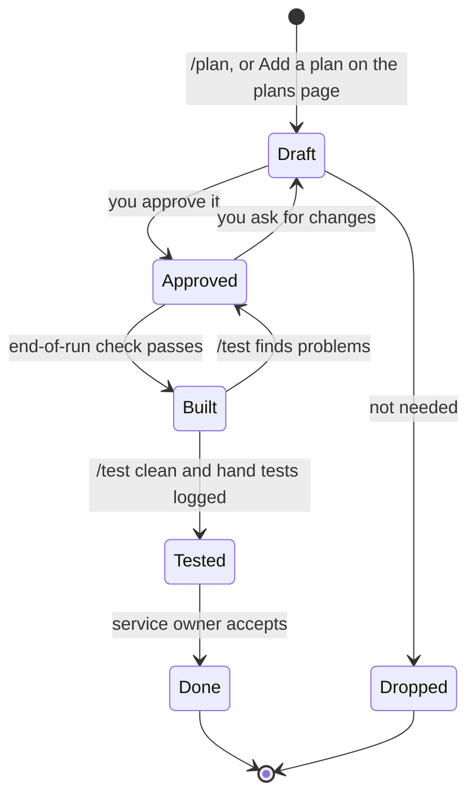
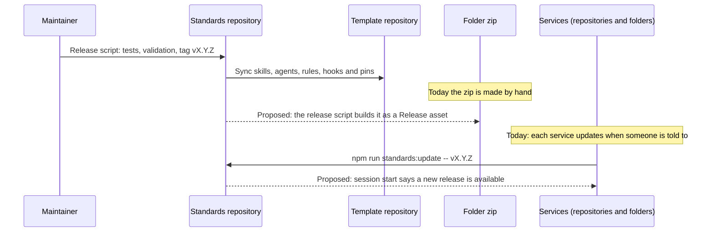

# The harness, end to end: a process review

*For the standards repository, `docs/process-review.md`. November 2026, release 0.6.1.*

This review walks through the whole way of working, from a new laptop to an improved standard, with a diagram for each part. Each section says what works, where the process leaks, and what to change. The last two sections set out how the harness can improve itself in a way that's safe for a council, and a suggested order of work.

The diagrams are Mermaid, so GitHub, VS Code and the workshop render them. Copy any of them into a presentation or an exercise.

## 1. The journey

**What works.** Every stage has one command and one person decision. The strongest model plans, the everyday model builds, a smaller model reviews. Nothing reaches the folder without the standards check and a review, and nothing is built outside the dev environment.

**Where it leaks.**

- The stages are one-way. Nothing records which plan is approved, built or tested, so `/next` works it out from the files each time, and "done" depends on someone remembering the hand tests.
- Set-up is the longest stage and the least guided after the first day: when a sign-in expires or a tool is missing, the person finds out by something failing.
- Discover and design happen once, but needs change. There's no prompt to revisit the requirements when a plan doesn't fit a user story.

**Improvements.** A plan lifecycle (section 6). A `/lbbexley:check-setup` command that checks every tool and sign-in and says what to fix, usable any time, not only on the first day. The plan skill says when a plan has no user story behind it and offers `/discover` for that story.

## 2. A build run and the end-of-run check

**What works.** The order is right: the latest version comes in before the review, so what's reviewed and committed is what's in the dev environment. The reviewer can't change anything. The gate now confirms the commit and push happened instead of assuming.

**Where it leaks.**

- The gate knows how many times it held the run, what the check found and what the reviewer said, and throws it all away when the run ends. That's the harness's own performance data, lost.
- The reviewer reads diffs of synced solution XML, which it can't judge well, alongside the canvas source it can. Nothing records whether its findings were useful.
- A fix cycle (check, fix, check again) costs time and tokens. Nothing counts cycles, so nobody knows which rules or skills cause the most rework.

**Improvements.** A harness event log (section 8): one line per event, counts and rule names only, no content. The review request lists synced files separately with a lighter brief ("check the names and prefixes; don't review generated XML line by line"). Each reviewer finding gets an outcome, fixed or dismissed with a reason, recorded by the gate when the next stop shows the file changed or didn't.

## 3. The guardrails

**What works.** Each guard has one question and three answers. Blocks are for things that can't be undone or can leave the environment; asks are for things that can reach people; everything else is quiet.

**Where it leaks.**

- The guards look at the operation, not the data. A `create_record` with a real resident's details, or a `run_flow` with a real email address in its inputs, goes ahead. The standards check catches personal data in files, but tool inputs never touch a file.
- Nothing records which guard fired and how often. A guard that blocks ten times a day is either doing vital work or getting in the way, and the Digital Team can't tell which.

**Improvements.** A personal-data check on tool inputs, using the same patterns as the standards check: Dataverse `create_record` and `update_record`, FlowAgent `run_flow` and `invoke_operation`, canvas `compile_canvas` (sample data in formulas). Block on a clear match, otherwise let it through. Guard decisions go in the event log.

## 4. The improvement loop today

The red boxes are where ideas are lost or delayed:

- **Ideas live in one service.** Twenty services log the same gap twenty times, and nobody sees the pattern. There's no aggregation until a maintainer reads twenty issues.
- **No GitHub, no proposal.** Folder users without the GitHub CLI get "text to send", which means an email that may never be written. The people least likely to raise an issue are the ones whose feedback matters most: new makers meeting the standards for the first time.
- **Updates are manual.** A release only helps a service once someone there runs `npm run standards:update`, and nothing tells them a release exists.
- **No evidence.** An idea is a sentence from a small model. The Digital Team can't tell a one-off from a daily problem, so triage is slow and cautious, which is right when evidence is missing and wrong when it isn't.
- **No regression test for the lesson.** When a gap is fixed, nothing stops the same gap coming back in a later edit to the skill.

## 5. The improvement loop proposed

The same loop, closed. Five changes:

1. **Measure.** Every service keeps a harness event log: which rule fired in which kind of file, which guard decided what, how many holds and fix cycles each run took, how many reviewer findings and what happened to them. Counts and names only: never file contents, prompts or personal data. It lives in `.lbbexley/log/` and is ignored by Git.
2. **Rank by evidence.** `/lbbexley:improve` reads the log as well as `improvements.md`, attaches the numbers to each idea ("rule canvas-colour-token fired 41 times in 12 runs, 39 fixed, 2 suppressed with a reason") and drops ideas with none.
3. **An inbox that works without GitHub.** GitHub issues stay the route for repositories. For folders, a **Harness proposals** table in a Digital Team Dataverse environment, written through the Dataverse MCP server the person already has, with a model-driven app for triage. A Power Platform team triaging Power Platform feedback in Dataverse is the natural fit, and it gives Information Governance one place to look.
4. **Draft, test, approve.** A weekly job in the standards repository groups and counts the inbox. For each idea a maintainer accepts, Claude Code (the GitHub Action, on the Digital Team's subscription) drafts the change to the skill, rule, check or template, plus a test or an eval case that would have caught the original gap, as a pull request. The tests and the skill evals run. A maintainer approves. People still decide every change to a rule or a guard; the harness does the reading, counting, drafting and testing.
5. **Close the loop.** The session-start hook compares the pinned release with the latest tag (one cheap request, off by default in managed settings if IG prefers) and says when a new release is out. After a release, the digest shows whether the numbers moved: did the rule fire less, did fix cycles fall?

### Four levels of self-improvement

| Level | What the harness does | Who decides | Where we are |
|---|---|---|---|
| 0 | Fixed rules, changed by hand | People | |
| 1 | Notices gaps and logs ideas; people apply or propose; people triage and release | People | **0.6.1** |
| 2 | Measures itself, aggregates across services, ranks ideas by evidence, tells services when a release is out | People | Proposed first |
| 3 | Drafts each accepted change with a test or eval; CI proves it; people approve | People approve, harness does the work | Proposed second |
| 4 | Low-risk classes (wording, examples, new test and eval cases) merge on green; rules and guards still need a person | People set the classes | Optional, later |

Level 3 is a truly self-improving harness in every sense that matters for a council: it finds its own gaps, proves them with numbers, writes the fix and the test, and shows that the fix worked, while a named person remains accountable for every rule. Level 4 is a governance decision, not a technical one; GOVERNANCE.md should say which classes, if any, may merge without a person, and the answer can be "none" for the first year.

### What makes it safe

- The event log holds counts and names only. The improve skill, not the log, writes the words people read, and the data-protection rules apply to proposals as they do to everything else.
- Changes to the guards' scripts and the hooks need a maintainer's approval at every level, and managed settings (`allowManagedHooksOnly`) stop a laptop from switching them off.
- Every accepted idea comes with a test or an eval case, so a lesson, once learned, stays learned. The evals run on every release, so a later change can't quietly undo an earlier fix.
- Skill evals run Claude against fixed scenarios ("build this screen from this plan; the result must use tokens and have one heading") with `claude plugin eval`. They cost tokens, so they run on release, not on every push.

## 6. A plan's life

Today a plan is a file with no state. Giving it one (a `status` line in its front matter, moved by the skills and the gate) makes three things possible: `/next` and the plans page show what's approved, built and tested at a glance; the end-of-run check can mark a plan built when the resources it names have changed and synced; and a release check can require that every built plan has a logged hand test before the service is called done. It also gives Information Governance the traceability they ask for: user story to plan to build to test, in files.

## 7. How a release reaches people

**Where it leaks.** The folder zip is made by hand, so it will drift from the template unless someone remembers it at each release. Services learn about releases by word of mouth.

**Improvements.** The release script builds the zip from the template and attaches it to a GitHub Release of the template repository, so the download link is always the current release. The session-start nudge (section 5) tells each service when to update.

## 8. The harness event log

One line of JSON per event, appended by the hooks to `.lbbexley/log/events.jsonl`, ignored by Git:

| Event | Recorded | Never recorded |
|---|---|---|
| Standards check after a save | rule id, severity, file kind (canvas, flow, html, doc), fixed later or not | file names, content, line text |
| Guard decision | guard, operation, decision (allow, ask, deny) | arguments, URLs, data |
| End-of-run hold | reason (sync, check, review, commit, push), count per run | |
| Reviewer | number of findings, number fixed, number dismissed with a reason, ideas logged | the findings' text |
| Run | plan name, kinds of resources changed, fix cycles, time to green | |

`/lbbexley:improve` summarises it; the person sees the summary before anything leaves the laptop. Information Governance signs off the schema once, and the data-protection skill's rules apply to the summary.

## 9. Suggested order of work

| Order | Change | Why first | Size | Lives in |
|---|---|---|---|---|
| 1 | Event log in the hooks, and `/lbbexley:improve` ranks by evidence | Everything else depends on measuring | Medium | Plugin |
| 2 | Release nudge at session start; the release script builds the zip | Closes the two leaks that cost nothing to close | Small | Plugin, release script |
| 3 | Personal-data check on tool inputs | The one guardrail gap with a governance consequence | Small | Plugin |
| 4 | Plan lifecycle, shown on the plans page and used by `/next` and the gate | Traceability, and "done" means tested | Medium | Plugin, template, folder |
| 5 | Dataverse proposals table and the weekly digest | Feedback from folder users, aggregated | Medium | Standards repo, a Digital Team environment |
| 6 | Skill evals with `claude plugin eval`, run on release | Lessons stay learned | Medium | Standards repo |
| 7 | Draft-change action on accepted ideas | Level 3 | Large | Standards repo, Digital Team subscription |
| 8 | Reviewer outcomes and a lighter brief for synced files | Better reviews, measured | Small | Plugin |
| 9 | `/lbbexley:check-setup` | Fewer stuck first days | Small | Plugin |

Items 1 to 4 and 8 to 9 fit one release (0.7.0) and need no decisions beyond the Digital Team's. Items 5 to 7 need an environment, a subscription for CI and a line in GOVERNANCE.md, so they're a conversation first.

## 10. Decisions needed

- **Information Governance:** the event log schema (section 8), and whether the release check (one request to GitHub at session start) is acceptable or stays off.
- **Digital Team:** a Dataverse environment for the proposals table, and whether Claude Code runs in GitHub Actions on the team's subscription to draft changes.
- **Governance board:** whether any class of change may merge without a person (level 4), and if so which.
